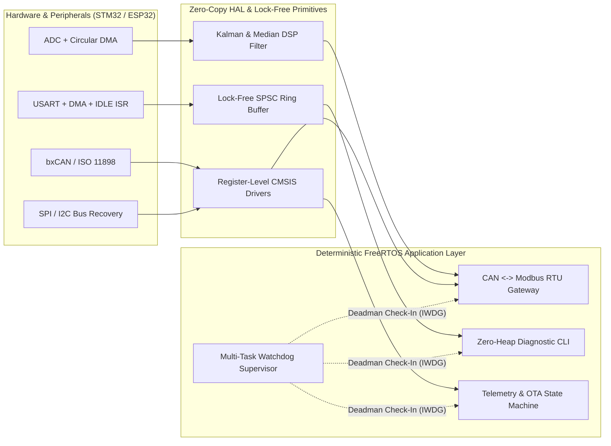

# Yiğit Çakırdoğan
### Embedded Systems & Firmware Engineer
**ARM Cortex-M (STM32) • FreeRTOS • Bare-Metal Drivers • Industrial Protocols (CAN / Modbus) • Industrial IoT (ESP32)**

---

## Engineering Profile

I design and implement **deterministic, resource-constrained embedded software** for microcontrollers and industrial nodes. My engineering approach prioritizes **predictable real-time execution**, **zero-copy peripheral DMA pipelines**, **hardware-decoupled driver architectures**, and **automated host-based verification**.

- **Bare-Metal & CMSIS Firmware:** Direct register-level peripheral bring-up (`RCC`, `GPIO`, `DMA`, `USART`, `SPI`, `I2C`, `TIM/PWM`, `ADC`, `IWDG`), custom GNU LD linker scripts, startup vector tables, and HardFault diagnostics on **STM32 (ARM Cortex-M4F/M7)**.
- **Real-Time Operating Systems (FreeRTOS):** Rate-monotonic task partitioning, static memory allocation (`xTaskCreateStatic`), lock-free ISR-to-task synchronization, priority-inheritance mutexes, and multi-task hardware watchdog supervision.
- **Industrial & Automotive Fieldbuses:** **CAN 2.0B (ISO 11898)** frame filtering/packing, **Modbus RTU (RS-485)** slave/master state machines with table-driven CRC-16, and deterministic binary command protocols.
- **Connected Industrial Edge & Control:** **ESP32 (ESP-IDF)** telemetry nodes with finite state machine (FSM) network resilience, 1D Kalman/median sensor conditioning, and discrete-time PID control algorithms.

---

## Reference Firmware Architecture

---

## Featured Engineering Repositories

| Repository | Architecture & Technical Highlights | Verification |
| :--- | :--- | :---: |
| **[`stm32-dma-ringbuffer-uart-cli`](https://github.com/Yigitcakirdogan/stm32-dma-ringbuffer-uart-cli)** | **Zero-Copy UART DMA + Lock-Free SPSC Ring Buffer & CLI** Uses `DMA1` Circular Mode + `USART_SR_IDLE` interrupt for variable-length packet reception with near-zero CPU overhead, paired with a static-memory diagnostic shell. |  |
| **[`freertos-canbus-modbus-gateway`](https://github.com/Yigitcakirdogan/freertos-canbus-modbus-gateway)** | **FreeRTOS CAN 2.0B to Modbus RTU Industrial Gateway** Bridges automotive/industrial CAN frames into RS-485 Modbus Holding/Input registers (`FC03`, `FC04`, `FC06`, `FC10`) with table-driven CRC-16 and task-level watchdog supervision. |  |
| **[`stm32f4-baremetal-hal-drivers`](https://github.com/Yigitcakirdogan/stm32f4-baremetal-hal-drivers)** | **Register-Level STM32F407 Drivers & Custom Linker Script** Pure CMSIS peripheral drivers (`GPIO`, `SPI`, `I2C` with 9-clock bus lockup recovery, `IWDG`), `Reset_Handler` startup in C, and `CCM-RAM` linker script—zero vendor HAL bloat. |  |
| **[`esp32-industrial-iot-telemetry-node`](https://github.com/Yigitcakirdogan/esp32-industrial-iot-telemetry-node)** | **Fault-Tolerant Industrial IoT Edge Node** Deterministic connection FSM with exponential backoff, 1D Kalman + Median-of-5 sensor filtering, CRC32 binary/JSON telemetry codec, and offline store-and-forward ring buffering. |  |
| **[`yay-kutle-sonum-sistemi`](https://github.com/Yigitcakirdogan/yay-kutle-sonum-sistemi)** | **Discrete-Time Control & Mass-Spring-Damper Simulation** Finite-difference discretization of $m\ddot{x} + c\dot{x} + kx = F(t)$ paired with an anti-windup, derivative-on-measurement Embedded C PID controller and Python step-response analysis. |  |

---

## Technical Stack & Tooling

| Domain | Technologies & Standards |
| :--- | :--- |
| **Languages & Standards** | `C (C99 / C11)`, `C++ (C++17 Embedded Subset)`, `Python 3`, `ARM Thumb-2 Assembly`, `GNU LD Linker Scripts` |
| **Microcontrollers & SoCs** | `STM32F4 / STM32F1 / STM32H7 (ARM Cortex-M3/M4F/M7)`, `ESP32 / ESP32-S3 (Xtensa / RISC-V)` |
| **RTOS & Concurrency** | `FreeRTOS (Static Allocation, Queues, Direct-to-Task Notifications, Mutexes)`, `Lock-Free Ring Buffers`, `DMA Double/Circular Buffering` |
| **Communication Protocols** | `CAN 2.0A/B (ISO 11898)`, `Modbus RTU (RS-485)`, `SPI`, `I2C (SMBus)`, `UART / RS-232`, `MQTT / TLS`, `BLE` |
| **Build, Test & Quality** | `CMake`, `GNU Arm Embedded Toolchain (arm-none-eabi-gcc)`, `CTest`, `Cppcheck Static Analysis`, `GitHub Actions CI/CD`, `GDB / OpenOCD` |
| **Hardware & Lab Debugging** | `Saleae Logic Analyzer`, `DSO Oscilloscope (Protocol Decoding & Timing Profiling)`, `ST-Link / J-Link SWD`, `Schematic Reading` |

---

## Core Firmware Design Principles

1. **Zero Dynamic Allocation After Init:** All queues, ring buffers, protocol contexts, and RTOS task control blocks (`StaticTask_t`) are statically allocated to eliminate heap fragmentation and guarantee bounded execution times.
2. **Interrupt Service Routines (ISRs) Stay Minimal:** ISRs only acknowledge hardware flags, update lock-free indices, or defer processing via `xQueueSendFromISR()` / DMA transfer-complete callbacks.
3. **Hardware Abstraction via Dependency Injection:** Peripheral drivers expose clean operations structs (`vtable`/ops pointers), enabling full host-side unit testing (`x86_64 GCC`) on every commit before flashing target silicon.
4. **Defensive Embedded Coding:** Hardware loops include explicit tick timeouts, I2C masters implement physical bus-unstick recovery, and Independent Watchdogs (`IWDG`) are gated by a multi-task deadman supervisor.
