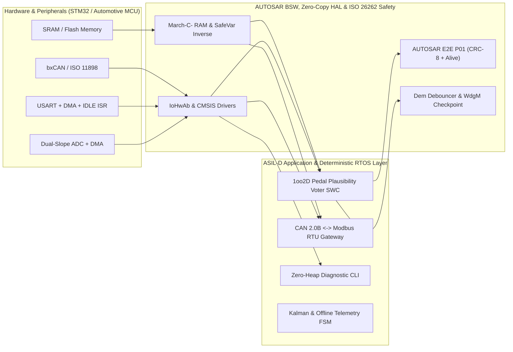

# Yiğit Çakırdoğan
### Embedded Systems & Functional Safety Firmware Engineer
**AUTOSAR Classic • ISO 26262 (ASIL-D) • MISRA C:2012 • ARM Cortex-M (STM32) • FreeRTOS • CAN / Modbus**

%20%7C%20MISRA%20C%3A2012-critical?style=flat-square&logo=c)
-00599C?style=flat-square)

---

## Engineering Profile

I design and implement **safety-critical, deterministic embedded software** for automotive ECUs, industrial controllers, and connected edge nodes. My engineering methodology combines **AUTOSAR Classic layered architecture**, **ISO 26262 (ASIL-B/D) functional safety mechanisms**, **MISRA C:2012 compliance**, **zero-copy DMA peripheral pipelines**, and **automated fault-injection unit testing**.

- **Automotive & Functional Safety (ISO 26262 / AUTOSAR / MISRA C):**
  - **AUTOSAR Classic R4.4:** Full layered design across `ASW` (Application SWCs), `RTE`, `BSW Services` (`Dem` counter-based debouncing, `WdgM` logical checkpoint graphs, `E2E Profile 1` SAE J1850 CRC-8 protection), `ECUAL` (`IoHwAb`), and `MCAL` (`Adc`, `Dio`).
  - **ISO 26262 ASIL-D Safety Mechanisms:** `1oo2D` dual-channel sensor plausibility voting, non-destructive windowed **March-C- SRAM self-tests**, redundant inverse variable storage (SEU protection), affine prime-signature **Control Flow Monitoring (CFM)**, and Flash CRC-32 verification.
- **Bare-Metal & CMSIS Firmware:** Direct register-level peripheral bring-up (`RCC`, `GPIO`, `DMA`, `USART`, `SPI`, `I2C`, `TIM/PWM`, `ADC`, `IWDG`), custom GNU LD linker scripts (`CCM-RAM`), startup vector tables, and HardFault stack frame diagnostics on **STM32 (ARM Cortex-M4F/M7)**.
- **Real-Time Operating Systems (FreeRTOS):** Rate-monotonic task partitioning, static memory allocation (`xTaskCreateStatic`), lock-free ISR-to-task synchronization, and multi-task hardware watchdog supervision.

---

## Reference Safety & Firmware Architecture

---

## Featured Engineering Repositories

| Repository | Architecture & Technical Highlights | Verification |
| :--- | :--- | :---: |
| **[`autosar-classic-bsw-rte-pedal-voter`](https://github.com/Yigitcakirdogan/autosar-classic-bsw-rte-pedal-voter)** | **AUTOSAR Classic ASIL-D 1oo2D Pedal Voter & E2E Stack** Complete `MCAL -> IoHwAb -> Dem / WdgM / E2E P01 -> RTE -> ASW` stack with dual-slope ratiometric sensor scaling, counter debouncing, Brake Override (`BOS`), and SAE J1850 CRC-8 protection. |  |
| **[`iso26262-misra-c-safety-library`](https://github.com/Yigitcakirdogan/iso26262-misra-c-safety-library)** | **ISO 26262-5/6 ASIL-D Software Safety Mechanisms in MISRA C:2012** Transparent windowed **March-C- SRAM test**, redundant inverse variables (`SafeVar_u32_t`), prime-signature **Control Flow Monitor (CFM)**, ROM CRC-32 verifier, and stack canary guards. |  |
| **[`stm32-dma-ringbuffer-uart-cli`](https://github.com/Yigitcakirdogan/stm32-dma-ringbuffer-uart-cli)** | **Zero-Copy UART DMA + Lock-Free SPSC Ring Buffer & CLI** Uses `DMA1` Circular Mode + `USART_SR_IDLE` interrupt for variable-length packet reception with near-zero CPU overhead, paired with a static-memory diagnostic shell. |  |
| **[`freertos-canbus-modbus-gateway`](https://github.com/Yigitcakirdogan/freertos-canbus-modbus-gateway)** | **FreeRTOS CAN 2.0B to Modbus RTU Industrial Gateway** Bridges automotive/industrial CAN frames into RS-485 Modbus Holding/Input registers (`FC03`, `FC04`, `FC06`, `FC10`) with table-driven CRC-16 and task-level watchdog supervision. |  |
| **[`stm32f4-baremetal-hal-drivers`](https://github.com/Yigitcakirdogan/stm32f4-baremetal-hal-drivers)** | **Register-Level STM32F407 Drivers & Custom Linker Script** Pure CMSIS peripheral drivers (`GPIO`, `SPI`, `I2C` with 9-clock bus lockup recovery, `IWDG`), `Reset_Handler` startup in C, and `CCM-RAM` linker script—zero vendor HAL bloat. |  |
| **[`esp32-industrial-iot-telemetry-node`](https://github.com/Yigitcakirdogan/esp32-industrial-iot-telemetry-node)** | **Fault-Tolerant Industrial IoT Edge Node** Deterministic connection FSM with exponential backoff, 1D Kalman + Median-of-5 sensor filtering, CRC32 binary/JSON telemetry codec, and offline store-and-forward ring buffering. |  |
| **[`yay-kutle-sonum-sistemi`](https://github.com/Yigitcakirdogan/yay-kutle-sonum-sistemi)** | **Discrete-Time Control & Mass-Spring-Damper Simulation** Finite-difference discretization of $m\ddot{x} + c\dot{x} + kx = F(t)$ paired with an anti-windup, derivative-on-measurement Embedded C PID controller and Python step-response analysis. |  |

---

## Technical Stack & Standards

| Domain | Technologies & Standards |
| :--- | :--- |
| **Safety & Automotive** | `ISO 26262 (ASIL-B / ASIL-D, HARA, FMEDA, 1oo2D, E2E)`, `AUTOSAR Classic R4.4 (ASW, RTE, BSW, Dem, WdgM, IoHwAb, MCAL)`, `MISRA C:2012 / C:2023`, `IEC 61508` |
| **Languages & Low-Level** | `C (C99 / C11 Strict Subset)`, `C++ (C++17 Embedded)`, `Python 3`, `ARM Thumb-2 Assembly`, `GNU LD Linker Scripts` |
| **Microcontrollers & SoCs** | `STM32F4 / STM32H7 (ARM Cortex-M4F/M7)`, `Automotive Cortex-M / TriCore Concepts`, `ESP32 / ESP32-S3` |
| **RTOS & Concurrency** | `FreeRTOS (Static Allocation, Rate Monotonic Scheduling, Queues, Mutexes)`, `Lock-Free SPSC Ring Buffers`, `Circular DMA` |
| **Communication Protocols** | `CAN 2.0A/B (ISO 11898)`, `AUTOSAR E2E Profile 1`, `Modbus RTU (RS-485)`, `SPI`, `I2C`, `UART`, `MQTT / TLS` |
| **Build, Test & Quality** | `CMake`, `GNU Arm Embedded Toolchain (arm-none-eabi-gcc)`, `CTest Fault-Injection Testing`, `GitHub Actions CI/CD`, `GDB / OpenOCD` |
